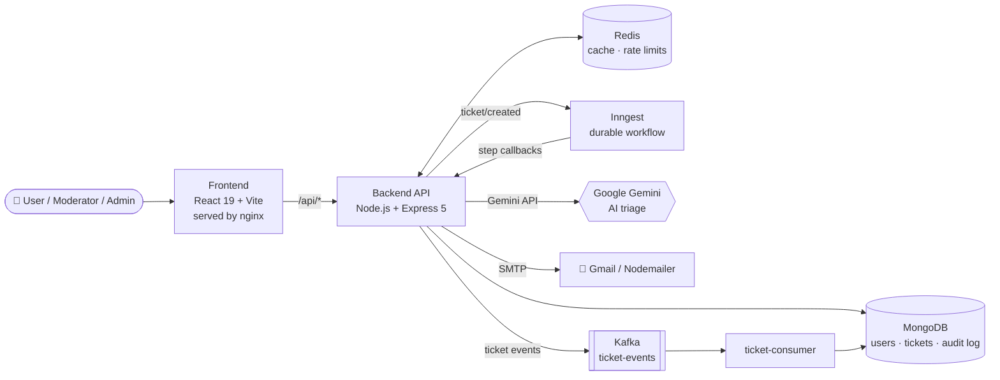
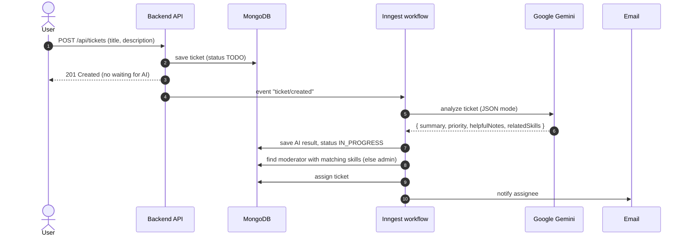
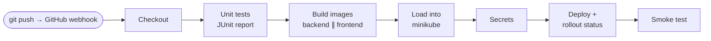

<div align="center">

# 🧠 SmartTicket AI

### AI-powered IT helpdesk that triages, prioritizes and routes support tickets automatically

Raise a ticket → **Google Gemini** reads it, sets the priority, finds the required skills and writes fix hints → the ticket is **auto-assigned** to the best-matched engineer, who gets an **email** within seconds.

<br/>


<br/>


<br/>


</div>

---

## 📑 Table of Contents

- [Why SmartTicket AI?](#-why-smartticket-ai)
- [Features](#-features)
- [Demo](#️-demo)
- [Architecture](#️-architecture)
- [How the AI Agent Works](#-how-the-ai-agent-works)
- [Tech Stack](#️-tech-stack)
- [Quick Start (Docker)](#-quick-start-docker)
- [Local Development (without Docker)](#-local-development-without-docker)
- [Environment Variables](#-environment-variables)
- [API Reference](#-api-reference)
- [Kafka Event Streaming](#-kafka-event-streaming)
- [Redis: Caching & Rate Limiting](#-redis-caching--rate-limiting)
- [Testing](#-testing)
- [Kubernetes Deployment](#️-kubernetes-deployment)
- [AWS EKS Deployment](#️-aws-eks-deployment)
- [CI/CD with Jenkins](#-cicd-with-jenkins)
- [Project Structure](#-project-structure)
- [Roadmap](#️-roadmap)
- [Author](#-author)

---

## 💡 Why SmartTicket AI?

In every IT company, the first minutes or hours of a support ticket are lost to **manual triage**: someone has to read it, guess the priority, figure out which skill is needed and find the right engineer. It is slow, inconsistent, and it does not scale.

**SmartTicket AI automates that triage layer**, so people spend their time **solving** problems, not sorting them.

| Without SmartTicket AI | With SmartTicket AI |
|---|---|
| A lead reads and forwards every ticket | Gemini triages each ticket in seconds, 24/7 |
| "Everything is urgent" | Consistent `low` / `medium` / `high` priority |
| Tickets bounce between the wrong people | Skill-based assignment to the right moderator |
| Engineers start research from zero | AI-written **helpful notes** with likely cause and resources |
| Users chase "who is on my issue?" | Live status tracking + email notifications |

> The AI does **not** replace the engineer. It removes the busywork before them, and humans stay in control: admins can edit, reprioritize or reassign any ticket.

---

## ✨ Features

**🤖 AI & automation**
- AI triage with **Google Gemini** in strict JSON mode: summary, priority, required skills, helpful notes
- **Skill-based auto-assignment** to moderators (falls back to an admin)
- **Durable background workflows** with Inngest: step-level retries, no duplicate work on replay
- **Graceful AI fallback**: if Gemini fails, the ticket is still saved and routed for manual review

**🔐 Security & access**
- JWT authentication with bcrypt-hashed passwords
- **Role-based access** (`user`, `moderator`, `admin`), enforced on the server in every controller
- **Redis-backed rate limiting** on login/signup (brute-force protection)
- Non-root containers, dropped Linux capabilities, Kubernetes NetworkPolicies

**📡 Events & performance**
- **Kafka event stream** (`ticket.created`, `ticket.assigned`, `ticket.updated`, `ticket.status_changed`) with an audit-log consumer
- **Redis cache** for authenticated user lookups
- Email notifications via Nodemailer (Gmail SMTP)

**🚀 DevOps**
- One-command local stack with **Docker Compose**
- **Kubernetes** manifests: autoscaling (HPA), PodDisruptionBudgets, NetworkPolicies, health probes, nightly MongoDB backups
- **Jenkins** pipeline: tests → images → deploy to minikube → smoke test
- **Vitest** unit tests with JUnit reports

---

## ▶️ Demo


---

## 🏗️ Architecture



**Key design decisions**

- **Accept fast, process eventually**: `POST /api/tickets` saves the ticket and returns `201` immediately. The slow, failure-prone AI work runs in the background, so an AI outage never breaks ticket creation.
- **Bounded AI**: the model only returns structured data. *Our code* decides what actions to take, which is safer and more predictable than giving an LLM free tool access.
- **Optional infrastructure**: Kafka and Redis are fail-open. Without them the app still runs exactly as before.

---

## 🔄 How the AI Agent Works



The Gemini response is treated as **untrusted input**: JSON mode, then stripping of markdown fences and surrounding text, field validation and normalization, and finally a safe fallback object if anything fails.

---

## 🛠️ Tech Stack

| Layer | Technology |
|---|---|
| **Frontend** | React 19, TypeScript, Vite 6, React Router 7, Tailwind CSS |
| **Backend** | Node.js 22, Express 5 (ES modules), Mongoose 8 |
| **AI** | Google Gemini (`gemini-2.5-pro`) via `@google/genai` |
| **Workflows** | Inngest (event-driven, durable steps) |
| **Messaging** | Apache Kafka 3.9 (KRaft, no ZooKeeper) via `kafkajs` |
| **Cache / rate limit** | Redis 7 |
| **Database** | MongoDB 7 |
| **Email** | Nodemailer (Gmail SMTP) |
| **Auth** | JWT + bcrypt, role-based access control |
| **Testing** | Vitest (+ JUnit reports) |
| **Containers** | Docker (multi-stage, non-root), Docker Compose |
| **Orchestration** | Kubernetes (minikube), Kustomize |
| **CI/CD** | Jenkins (declarative pipeline) |

---

## 🚀 Quick Start (Docker)

**Prerequisites:** Docker Desktop.

```bash
git clone https://github.com/anshuraj1996/Ticket-AI.git
cd Ticket-AI

cp .env.example .env          # add JWT_SECRET, GEMINI_API_KEY, GMAIL_USER, GMAIL_PASS
docker compose up --build -d
```

| Service | URL |
|---|---|
| 🌐 **App** (nginx proxies `/api` to the backend) | http://localhost:8080 |
| ⚙️ Backend API (direct) | http://localhost:3000 |
| 🔁 Inngest dev dashboard | http://localhost:8288 |
| 📨 Kafka UI | http://localhost:8081 |
| 🍃 MongoDB | `mongodb://localhost:27017` |
| ⚡ Redis | `redis://localhost:6379` |

```bash
docker compose logs -f backend          # follow backend logs
docker compose logs -f ticket-consumer  # watch Kafka events being audited
docker compose down                     # stop (data is kept)
docker compose down -v                  # stop and delete all data
```

> **Note:** the Inngest dev server is pinned to `v1.12.0`, because newer versions reject the `inngest@3.40` SDK (`sdk_version_denied`). Upgrade both together.

---

## 💻 Local Development (without Docker)

You need Node.js 22+ and a MongoDB instance. Kafka and Redis are optional.

```bash
# Backend
cd BACKEND
npm install
cp ../.env.example .env        # also set MONGO_URI=mongodb://localhost:27017/smartticket
npm run dev                    # API on http://localhost:3000

# Inngest dev server (second terminal)
npm run inngest-dev

# Kafka audit consumer (optional, needs KAFKA_BROKERS)
npm run consumer

# Frontend (third terminal)
cd ../FRONTEND
npm install
echo "VITE_API_URL=http://localhost:3000/api" > .env.local
npm run dev
```

---

## 🔑 Environment Variables

| Variable | Required | Description |
|---|:---:|---|
| `JWT_SECRET` | ✅ | Secret for signing JWTs (long random string) |
| `GEMINI_API_KEY` | ✅ | Google AI Studio API key |
| `GMAIL_USER` / `GMAIL_PASS` | ✅ | Gmail address + **App Password** for notifications |
| `MONGO_URI` | ✅ | MongoDB connection string (set automatically in Docker/K8s) |
| `PORT` | | API port (default `3000`) |
| `APP_URL` | | Public URL of the app |
| `KAFKA_BROKERS` | | e.g. `kafka:9092`. Unset = Kafka disabled |
| `KAFKA_TICKET_TOPIC` | | Default `ticket-events` |
| `REDIS_URL` | | e.g. `redis://redis:6379`. Unset = no cache / rate limit |
| `USER_CACHE_TTL_SECONDS` | | Auth user cache TTL (default `60`) |
| `AUTH_RATE_LIMIT_MAX` / `AUTH_RATE_LIMIT_WINDOW_SECONDS` | | Login/signup limit (default `10` per `900` s) |
| `INNGEST_DEV` / `INNGEST_BASE_URL` | | Use the local Inngest dev server |
| `INNGEST_EVENT_KEY` / `INNGEST_SIGNING_KEY` | | Inngest Cloud keys (production) |
| `VITE_API_URL` | | Frontend **build-time** API base (default `/api`) |

> 🔒 Never commit `.env`. It is already listed in `.gitignore` and `.dockerignore`.

---

## 📡 API Reference

All routes are prefixed with `/api`. 🔒 = requires `Authorization: Bearer <token>`.

| Method | Endpoint | Access | Description |
|---|---|---|---|
| `POST` | `/auth/signup` | Public (rate limited) | Register, returns `{ user, token }` |
| `POST` | `/auth/login` | Public (rate limited) | Log in, returns `{ user, token }` |
| `POST` | `/auth/logout` | 🔒 | Log out |
| `GET` | `/auth/users` | 🔒 Admin | List all users |
| `POST` | `/auth/update-user` | 🔒 Admin / self | Update skills (and role, admin only) |
| `POST` | `/tickets` | 🔒 | Create a ticket (triggers AI triage) |
| `GET` | `/tickets` | 🔒 | List tickets (scoped by role) |
| `GET` | `/tickets/:id` | 🔒 | Ticket details incl. AI notes |
| `PUT` | `/tickets/:id` | 🔒 Admin | Edit title, description, assignee |
| `PUT` | `/tickets/:id/status` | 🔒 Admin / Moderator / Assignee | Update status (`OPEN`, `IN_PROGRESS`, `RESOLVED`, `CLOSED`) |

Health endpoints: `GET /` (liveness) and `GET /readyz` (readiness, `503` until MongoDB is connected).

---

## 📨 Kafka Event Streaming

Kafka runs **alongside** Inngest: Inngest runs the AI workflow, and Kafka publishes every ticket lifecycle change to the `ticket-events` topic so other services can react without touching the API.

| Event | Published from | When |
|---|---|---|
| `ticket.created` | `createTicket` | A user raises a ticket |
| `ticket.assigned` | Inngest `assign-moderator` step | AI triage assigned a moderator/admin |
| `ticket.updated` | `updateTicket` | An admin edits a ticket |
| `ticket.status_changed` | `updateTicketStatus` | Status changes (includes `previousStatus`) |

<details>
<summary>Message format and delivery guarantees</summary>

```json
{
  "eventId": "uuid",
  "type": "ticket.assigned",
  "occurredAt": "2026-10-09T11:35:40.000Z",
  "ticketId": "…",
  "data": { "title": "…", "status": "IN_PROGRESS", "priority": "medium", "relatedSkills": [], "assignedTo": "…", "createdBy": "…" }
}
```

- **Ordering per ticket:** messages are keyed by `ticketId`, so one ticket's events stay in one partition.
- **At-least-once + dedupe:** the `ticket-consumer` stores `eventId` with a unique index and skips duplicates.
- **Never blocks the API:** publish failures are logged, not thrown.
- **No double publish on replay:** `ticket.assigned` is published inside an Inngest step.

</details>

---

## ⚡ Redis: Caching & Rate Limiting

| Feature | How it works |
|---|---|
| **Login/signup rate limit** | 10 attempts per IP per 15 min, shared across all API replicas. Returns `429` + `Retry-After`. |
| **User lookup cache** | `authenticate` caches the user for 60 s instead of hitting MongoDB on every request. Role changes clear the entry immediately. |

Both are **fail-open**: if Redis is down or not configured, requests go straight to MongoDB. `trust proxy` is enabled so the real client IP is used behind nginx/Kubernetes.

---

## 🧪 Testing

Backend unit tests use **Vitest**. MongoDB, Redis, Kafka and Gemini are mocked, so no services are needed.

```bash
cd BACKEND
npm test             # run once
npm run test:watch   # watch mode
npm run test:ci      # + JUnit report (reports/junit.xml), used by Jenkins
```

| Suite | Covers |
|---|---|
| `ai.test.js` | Gemini JSON parsing: code fences, chatter, invalid priority, skills as string, fallback on bad JSON / API error |
| `auth.test.js` | Missing/invalid/forged JWT, cache hit & miss, deleted user |
| `rateLimit.test.js` | Limit, `429` + `Retry-After`, per-IP counters, fail-open |
| `ticket.controller.test.js` | Validation, `403`/`404`, Inngest + Kafka events |
| `optional-services.test.js` | App works without Kafka / Redis configured |

---

## ☸️ Kubernetes Deployment

Production-style manifests for **minikube**, managed with Kustomize (`k8s/`). Full guide: [`k8s/README.md`](k8s/README.md).

```bash
bash k8s/deploy-minikube.sh                         # build, load images, create Secret, apply everything
minikube service frontend -n smartticket --url      # open the app (NodePort)
# or via Ingress: http://smartticket.local  (minikube addons enable ingress + minikube tunnel)
bash k8s/mk-kubectl.sh -n smartticket get pods      # status
```

| Capability | Implementation |
|---|---|
| **Workloads** | Backend API, Kafka consumer, frontend (Deployments); MongoDB, Kafka (StatefulSets + PVCs); Redis, Inngest |
| **Health** | Readiness (`/readyz`), liveness probes, init containers that wait for dependencies |
| **Scaling** | HPA: backend 2–5, frontend 2–4 pods on CPU |
| **Availability** | Zero-downtime rolling updates, PodDisruptionBudgets |
| **Security** | Non-root pods, dropped capabilities, no service-account tokens, default-deny NetworkPolicies, Secrets for credentials |
| **Backups** | Nightly `mongodump` CronJob, 7-day retention |
| **Graceful shutdown** | `SIGTERM` handling closes HTTP server, Kafka, Redis and MongoDB cleanly |
| **Ingress** | `http://smartticket.local` → frontend nginx → `/api` → backend (TLS-ready) |

> No container registry is needed for minikube: images are copied in with `docker save | docker exec -i minikube docker load`.

### ⎈ Helm chart

The same app is also packaged as a **Helm chart** in [`helm/smartticket`](helm/README.md): one chart, per-environment values, `helm upgrade` / `helm rollback`.

```bash
helm upgrade --install smartticket helm/smartticket -n smartticket --create-namespace \
  --set secrets.existingSecret=backend-secrets
```

[`values-prod.example.yaml`](helm/smartticket/values-prod.example.yaml) shows a production setup: registry images, managed MongoDB/Kafka/Redis, Inngest Cloud, HTTPS via cert-manager.

---

## ☁️ AWS EKS Deployment

Production-style deployment to **Amazon EKS**. Full guide: [`eks/README.md`](eks/README.md).

```bash
terraform -chdir=eks/terraform init && terraform -chdir=eks/terraform apply   # VPC, EKS, ECR, IAM
bash eks/scripts/bootstrap.sh      # gp3, AWS Load Balancer Controller, metrics-server
bash eks/scripts/deploy.sh         # build → push to ECR → helm upgrade --atomic → ALB URL
bash eks/scripts/destroy.sh        # safe teardown (ALB and volumes first, then Terraform)
```

| Layer | AWS implementation |
|---|---|
| Infrastructure as Code | Terraform: VPC (3 AZs), EKS + managed node group, ECR, IRSA roles |
| Ingress | ALB via the AWS Load Balancer Controller, optional HTTPS with ACM |
| Storage | EBS gp3 (encrypted) via the EBS CSI driver |
| Security | Private nodes, IRSA least privilege, namespace-scoped CI access entry, VPC CNI NetworkPolicies |
| CI/CD | [`Jenkinsfile.eks`](Jenkinsfile.eks): tests → ECR push → Helm deploy with auto-rollback → smoke test |

---

## 🔁 CI/CD with Jenkins



- The agent only needs `git`, `bash` and the `docker` CLI. Tests run inside the backend `test` image, and kubectl runs inside the minikube container.
- Images are tagged with the **build number** and rolled out with `kubectl set image`.
- Optional credential **`smartticket-env`** (Secret file = your `.env`) creates/updates the Kubernetes Secret.
- The **`DEPLOY`** parameter lets you run tests and builds without deploying.
- **Automatic builds:** a GitHub **push webhook** triggers the pipeline (`githubPush()`), with SCM polling every 5 minutes as a fallback. Only `main` deploys; other branches and PRs run tests and builds only.
- **Local Jenkins?** GitHub can't reach `localhost`, so [`ci/webhook`](ci/webhook/docker-compose.yml) runs a **smee.io relay** that forwards webhook events without opening any ports.
- The EKS pipeline stays **manual** on purpose (cloud costs).
- Setup guide (Jenkins job, webhook, secret, troubleshooting): [`ci/README.md`](ci/README.md).

---

## 📂 Project Structure

```
Ticket-AI/
├── BACKEND/
│   ├── controllers/          # ticket + user business logic, RBAC
│   ├── middlewares/          # auth (JWT + Redis cache), rateLimit (Redis)
│   ├── models/               # User, Ticket, TicketEvent (audit log)
│   ├── routes/               # /api/auth, /api/tickets
│   ├── inngest/              # client + workflows (on-signup, on-ticket-create)
│   ├── kafka/                # client, producer, consumer
│   ├── utils/                # ai.js (Gemini), mailer, redis, cache
│   ├── tests/                # Vitest unit tests
│   ├── Dockerfile            # multi-stage: deps → test → runtime (non-root)
│   └── index.js              # Express app, health checks, graceful shutdown
├── FRONTEND/
│   ├── components/           # admin, auth, common, tickets
│   ├── contexts/ hooks/      # AuthContext, useAuth
│   ├── services/api.ts       # API client
│   ├── Dockerfile            # Vite build → nginx-unprivileged
│   └── nginx.conf.template   # SPA + /api reverse proxy
├── k8s/                      # Kubernetes manifests (Kustomize) + deploy scripts
├── helm/smartticket/         # Helm chart (same app, values per environment, incl. values-eks.yaml)
├── eks/                      # AWS EKS: Terraform, bootstrap/deploy/destroy scripts
├── Jenkinsfile.eks           # CI/CD pipeline for EKS (ECR + Helm)
├── ci/                       # Jenkins + GitHub webhook setup, smee.io relay for local Jenkins
├── docker-compose.yml        # full local stack
├── Jenkinsfile               # CI/CD pipeline
├── .env.example
```

---

## 🗺️ Roadmap

- [ ] Real-time ticket updates in the UI (Server-Sent Events)
- [ ] `responseSchema` enums for Gemini output + canonical skills taxonomy
- [ ] Load-aware assignment (fewest open tickets)
- [ ] RAG over resolved tickets for company-specific helpful notes
- [ ] httpOnly cookie auth with refresh tokens
- [ ] MongoDB authentication + off-cluster backups
- [ ] Frontend tests and E2E tests (Playwright)

---

## 👨‍💻 Author

<div align="center">

### **Anshuman Singh**

[](https://github.com/anshuraj1996)

</div>

---

## 🙌 Acknowledgements

- Based on the original [SmartTicket-AI](https://github.com/rajveer-09/SmartTicket-AI) by Rajveer Sharma, extended with Kafka, Redis, tests, Docker, Kubernetes and Jenkins CI/CD.
- [Inngest](https://www.inngest.com/) for durable workflows · [Google AI Studio](https://aistudio.google.com/) for Gemini · [Nodemailer](https://nodemailer.com/) for email.

## 📄 License

Released under the **MIT License**.

<div align="center">

⭐ If this project helped you, consider giving it a star!

</div>
