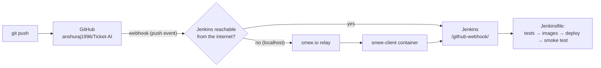

# CI/CD: Jenkins + GitHub Webhook

Every `git push` to GitHub starts the Jenkins pipeline automatically:



| Pipeline | Trigger | Deploys |
|---|---|---|
| [`Jenkinsfile`](../Jenkinsfile) (minikube) | GitHub push webhook + poll every 5 min (fallback) | `main` only; other branches/PRs run tests + builds |
| [`Jenkinsfile.eks`](../Jenkinsfile.eks) (AWS) | Manual (Build with Parameters) | Yes, on purpose (costs money) |

## 1) Jenkins job

1. Plugins (usually installed with the suggested set): **Pipeline**, **Git**, **GitHub**, **JUnit**.
   For the EKS pipeline also: **CloudBees AWS Credentials**.
2. **New Item → Pipeline** (or **Multibranch Pipeline** to also build PRs/branches).
3. *Pipeline script from SCM* → Git:
   - Repository URL: `git@github.com:anshuraj1996/Ticket-AI.git`
   - Credentials: *SSH Username with private key* (user `git`) with a key that can read the repo
     (e.g. a read-only **deploy key** added under GitHub → repo → Settings → Deploy keys)
   - Branch: `*/main` · Script path: `Jenkinsfile`
4. Under **Build Triggers**, tick **GitHub hook trigger for GITScm polling**.
   (The `triggers { githubPush() }` block in the Jenkinsfile sets this too after the first run.)
5. Run the job once by hand. Jenkins only registers the triggers from the Jenkinsfile after a first build.

## 2) GitHub webhook

### A. Jenkins has a public URL (cloud VM, company server)

GitHub → repo **Settings → Webhooks → Add webhook**:

| Field | Value |
|---|---|
| Payload URL | `https://<your-jenkins>/github-webhook/` (trailing slash required) |
| Content type | `application/json` |
| Secret | a long random string (see step 3) |
| Events | **Just the push event** (add *Pull requests* for a multibranch job) |

### B. Jenkins runs locally (Docker on your laptop)

GitHub can't reach `localhost`, so relay the events through smee.io:

```bash
# 1. https://smee.io → "Start a new channel" → copy the URL
cp ci/webhook/.env.example ci/webhook/.env      # paste the URL as SMEE_URL
docker compose -f ci/webhook/docker-compose.yml up -d
docker compose -f ci/webhook/docker-compose.yml logs -f   # "Forwarding https://smee.io/... to http://..."
```

Then add the GitHub webhook as in **A**, but with **Payload URL = your smee.io channel URL**.

> Alternative: `ngrok http 8080` and use `https://<id>.ngrok-free.app/github-webhook/` as the Payload URL.
> If neither is possible, the `pollSCM('H/5 * * * *')` fallback still builds within 5 minutes.

## 3) Webhook secret (recommended)

Proves to Jenkins that the call really came from GitHub (HMAC-SHA256 signature).

1. Jenkins → **Manage Jenkins → Credentials** → add **Secret text** with your random string
   (e.g. id `github-webhook-secret`).
2. Jenkins → **Manage Jenkins → System → GitHub → Advanced → Shared secrets** → select it.
3. Put the **same string** in the GitHub webhook's **Secret** field.

## 4) Verify

1. GitHub → Settings → Webhooks → your webhook → **Recent Deliveries**: the latest delivery
   should show a green ✔ with response `200`.
2. Push a small commit to `main`. A new build should appear in Jenkins within seconds,
   with *"Started by GitHub push by anshuraj1996"* in the build log.
3. Jenkins job page → **GitHub Hook Log** shows what was received.

| Symptom | Fix |
|---|---|
| Delivery fails with 403 | Webhook secret mismatch between GitHub and Jenkins |
| Delivery fails with 404 | Payload URL missing the trailing `/github-webhook/` |
| Delivery OK but no build | Job not run once by hand yet, or branch filter doesn't match `main` |
| Delivery timeout | Jenkins not reachable: use the smee relay (2B) |
