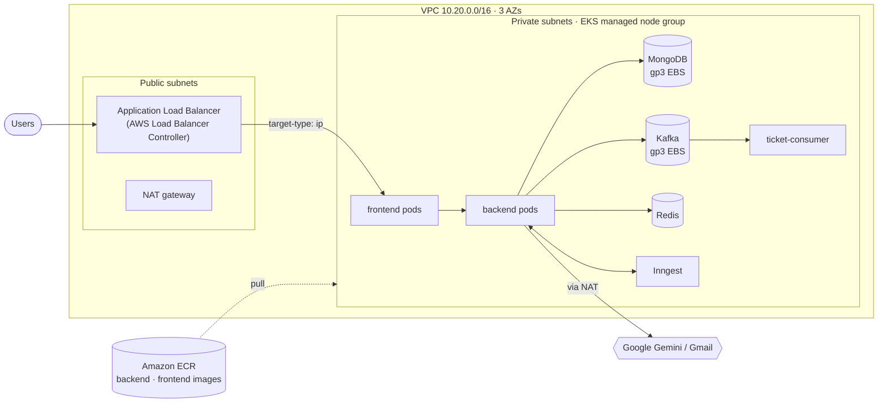

# SmartTicket AI on AWS EKS

Everything needed to run SmartTicket AI on **Amazon EKS**: infrastructure as code (Terraform),
one-time cluster bootstrap, Helm deploy, Jenkins pipeline and a safe teardown.

## Architecture



| Piece | What creates it |
|---|---|
| VPC, subnets, NAT gateway | Terraform (`terraform-aws-modules/vpc`) |
| EKS cluster, managed nodes, add-ons (VPC CNI with NetworkPolicy, CoreDNS, kube-proxy, EBS CSI, Pod Identity) | Terraform (`terraform-aws-modules/eks`) |
| IAM roles for service accounts (EBS CSI, Load Balancer Controller) | Terraform (IRSA) |
| ECR repositories (immutable tags, scan on push, keep last 30) | Terraform |
| gp3 StorageClass, AWS Load Balancer Controller, metrics-server | `scripts/bootstrap.sh` |
| The app | Helm chart + `helm/smartticket/values-eks.yaml` (`scripts/deploy.sh` or `Jenkinsfile.eks`) |

## Prerequisites

- AWS account + credentials (`aws configure`) with rights to create VPC/EKS/IAM/ECR
- Terraform ≥ 1.5, AWS CLI v2, kubectl, Helm 3, Docker, bash (Git Bash on Windows)

> ⚠️ **Cost:** EKS control plane (~$0.10/h) + 2× t3.medium + NAT gateway + ALB + EBS volumes,
> roughly **$6–8 per day**. Run `scripts/destroy.sh` when you're done.

## 1) Create the infrastructure

```bash
cd eks/terraform
cp terraform.tfvars.example terraform.tfvars     # region, node sizes, optional ci_principal_arn
# optional: cp backend.tf.example backend.tf     # remote state in S3
terraform init
terraform plan
terraform apply                                  # ~15-20 minutes
cd ../..
```

## 2) Bootstrap the cluster (once)

```bash
bash eks/scripts/bootstrap.sh
```

Configures kubectl, makes **gp3** the default StorageClass, installs the **AWS Load Balancer
Controller** (with its IRSA role) and **metrics-server**, and creates the `smartticket` namespace.

## 3) Deploy the app

```bash
cp .env.example .env            # JWT_SECRET, GEMINI_API_KEY, GMAIL_USER, GMAIL_PASS
bash eks/scripts/deploy.sh      # build → push to ECR → Secret → helm upgrade --atomic
```

The script prints the ALB URL (`http://k8s-smarttic-....elb.amazonaws.com`).

With your own domain and HTTPS (ACM certificate in the same region):
```bash
HOST=smartticket.example.com \
CERT_ARN=arn:aws:acm:ap-south-1:123456789012:certificate/abcd-... \
bash eks/scripts/deploy.sh
# then point a Route 53 / DNS CNAME (or alias) record at the ALB hostname
```

## 4) CI/CD with Jenkins

[`Jenkinsfile.eks`](../Jenkinsfile.eks): **Checkout → Unit tests → Build & push to ECR → Helm deploy (`--atomic`) → Smoke test**.

- Agent tools: git, bash, docker, aws CLI v2, kubectl, helm
- Credential `aws-smartticket` (AWS credentials). Put its IAM ARN in `ci_principal_arn`
  in `terraform.tfvars`: Terraform then gives it admin rights **only in the `smartticket` namespace**
  (EKS access entry). It also needs IAM permissions for ECR push and `eks:DescribeCluster`.
- Optional credential `smartticket-env` (Secret file) for the backend Secret
- Images are tagged `<build>-<git sha>` (ECR tags are immutable)

## Day-2 operations

```bash
kubectl -n smartticket get pods,hpa,ingress
helm -n smartticket history smartticket
helm -n smartticket rollback smartticket <revision>      # instant rollback
kubectl -n smartticket create job --from=cronjob/mongo-backup mongo-backup-manual
```

## 5) Tear down

```bash
bash eks/scripts/destroy.sh
```

Order matters: the script uninstalls the Helm release first so the Load Balancer Controller
deletes the ALB, deletes the namespace so the EBS volumes are released, and only then runs
`terraform destroy`. Otherwise leftover ALB network interfaces block the VPC deletion.

## Production hardening (next steps)

- Managed data services instead of in-cluster StatefulSets: MongoDB Atlas / Amazon DocumentDB,
  Amazon MSK, ElastiCache for Redis (see `helm/smartticket/values-prod.example.yaml`)
- Inngest Cloud instead of the dev server (`inngest.enabled=false`, `config.inngest.dev=false`)
- Secrets from AWS Secrets Manager via the External Secrets Operator
- One NAT gateway per AZ (`single_nat_gateway = false`), private API endpoint, AWS WAF on the ALB
- Cluster Autoscaler or Karpenter for node scaling (the HPA only scales pods)

> **Corporate antivirus note:** if kubectl/helm fail with `x509: certificate signed by unknown
> authority` (HTTPS scanning, as with minikube on this machine), run the scripts from Jenkins or
> AWS CloudShell instead of the local machine.
